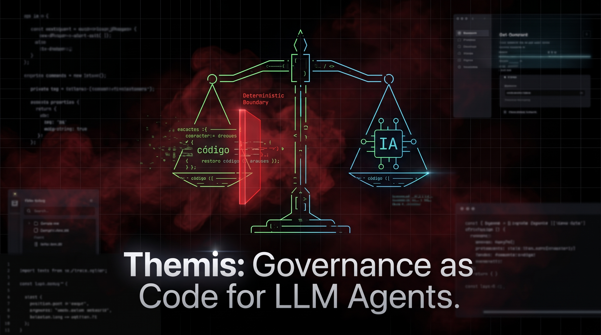

# ⚖️ Themis — Deterministic Governance Protocol for LLM Agents

> **Default branch (`main`) is in Spanish. Branch `english` contains the English documentation.**

[](https://opensource.org/licenses/MIT)
[](https://www.python.org/)
[](https://github.com/Andres34r7y4/themis/pulls)
[](https://github.com/sponsors/Andres34r7y4)
[](https://github.com/Andres34r7y4/themis/actions/workflows/ci.yml)

Themis is an autonomous, deterministic, multi-role governance protocol for any
repository using LLM-based agents. Its purpose is to make **the AI's path in
production predictable** through mandatory guidelines that define who decides,
who executes, and who audits.

---

## 🎯 The Problem

Current LLM agents operate as a "black box": they execute commands, modify files,
and make decisions without a strict governance framework. This generates:

- ❌ Unverifiable changes in production
- ❌ Lack of traceability of who made which decision
- ❌ No damage containment on errors
- ❌ Confusion between planning, execution, and auditing roles

---

## ✅ The Solution: Themis

Themis introduces a **governance kernel** (`agent.md`) that the LLM must consume
before any action. It defines a closed and mandatory state flow that guarantees
predictability.

### Key Features

| Feature | Description |
|---------|-------------|
| 🔒 **Mandatory PRE-FLIGHT** | No agent acts without declaring ROLE, CYCLE_ID, and MODE |
| 🏗️ **Role Separation** | Planner, Executor, Debugger, Security, QA, Architect, Documentator, DevOps, Product Owner, Designer |
| 🔄 **State Loop** | PLANNER → EXECUTOR → STOP with controlled phases and gates |
| ❄️ **Context Freeze** | Deterministic scope map before executing changes |
| 🛡️ **Anti-Catastrophe** | Automatic blocking if a task touches >5 files or is non-atomic |
| 📋 **Full Traceability** | Log in `task-archives.md` with CYCLE_ID, files touched, and real commands |
| 🧩 **Agnostic** | Works with any LLM (OpenAI, Anthropic, DeepSeek, Ollama, etc.) |
| 🧰 **CLI included** | `themis init`, `themis validate`, and `themis run-cycle` |

---

## 📁 Repository Structure

```text
themis/
├── .github/
│   ├── FUNDING.yml
│   ├── ISSUE_TEMPLATE/
│   ├── PULL_REQUEST_TEMPLATE.md
│   └── workflows/ci.yml
├── core/
│   ├── kernel.py              # PRE-FLIGHT and structure validation
│   ├── loop.py                # Deterministic state machine
│   └── roles.py               # Role registry and boundaries
├── docs/
│   ├── assets/
│   │   └── themis-banner.jpeg # Official banner image
│   ├── ARCHITECTURE.md        # State machine and role hierarchy
│   ├── EXAMPLES.md            # LLM integration examples
│   ├── SECURITY.md            # Security policy
│   └── guia-uso.md            # Operational guide
├── tests/
│   └── test_governance.py     # Kernel, CLI, loop, and role tests
├── themis/
│   ├── agent.md               # Governance kernel (central contract)
│   ├── PATHS.md               # Single source of paths
│   ├── loops/
│   │   ├── roles-loop.md      # State and phase orchestration
│   │   ├── context-freeze.md  # Context freezing
│   │   └── memory-loop.md     # Memory loop and traceability
│   ├── roles/                 # Ten role contracts
│   ├── tasks/
│   │   ├── tasks.md           # Active cycle tasks
│   │   └── archives/          # Completed task log
│   └── templates/             # Initial prompt, task, and backlog templates
├── cli.py                     # Command-line interface
├── pyproject.toml             # Packaging and entry point
├── LICENSE                    # MIT License
├── README.md                  # This file
├── CONTRIBUTING.md            # Contribution guide
└── CHANGELOG.md               # Change log
```

---

## 🚀 Quick Start

### 1. Clone the repository

```bash
git clone https://github.com/Andres34r7y4/themis.git
cd themis
```

### 2. Install the CLI

```bash
python -m pip install -e .
themis --version
```

You can also run it without installing:

```bash
python cli.py --help
```

### 3. Scaffold governance in your project

```bash
themis init --repo ./my-project
themis validate --repo ./my-project
```

### 4. Read the governance kernel

The file `themis/agent.md` is the **central contract**. Every agent must read it
before acting:

```text
PRE-FLIGHT (MANDATORY)
Before taking any action or response, the agent MUST:
1) Identify and declare: ROLE, CYCLE_ID, MODE
2) Read and strictly obey: agent.md → roles-loop.md → roles/<ROLE>.md
3) Print: PRE-FLIGHT OK
```

### 5. Execute a governance cycle

1. **PLANNER_PHASE**: the Planner decomposes the objective into atomic tasks in `tasks.md`.
2. **EXECUTOR_PHASE**: the Executor implements ONLY what is defined in `tasks.md`.
3. **STOP**: the cycle ends when tasks are complete or the 3-task limit is reached.

```bash
themis run-cycle --role planner
themis run-cycle --role executor
```

---

## 🧰 CLI Reference

| Command | Description |
|---------|-------------|
| `themis init [--repo PATH] [--base-dir NAME] [--force]` | Scaffold the governance structure |
| `themis validate [--repo PATH] [--base-dir NAME]` | Validate structure and PRE-FLIGHT readiness |
| `themis run-cycle --role ROLE [--mode MODE] [--cycle-id ID]` | Execute PRE-FLIGHT for a role |

Exit codes: `0` success, `1` governance/structure error, `2` invalid CLI usage.

---

## 🏛️ Roles and Responsibilities

| Role | Main Responsibility | Can touch code |
|------|---------------------|----------------|
| **Planner** | Decomposes objectives, defines backlog and atomic tasks | ❌ No |
| **Executor** | Implements minimal and verifiable changes | ✅ Yes (only tasks.md) |
| **Debugger** | Diagnoses bugs, produces evidence, does not apply definitive fixes | ❌ No |
| **Security Engineer** | Validates security in all cycles with changes | ❌ No (veto only) |
| **QA Engineer** | Validates acceptance pre-STOP in code cycles | ❌ No (veto only) |
| **Architect** | Gate when a cycle touches structure, contracts, or dependencies | ❌ No (veto only) |
| **Documentator** | Validates deliverable documentation | ❌ No (veto only) |
| **DevOps** | Gate of hooks, pipeline, worktrees, and rollback | ❌ No (veto only) |
| **Product Owner** | Gate pre-planning (value and acceptance) | ❌ No (veto only) |
| **Designer** | Proposes visual solutions with measurable criteria | ❌ No (veto only) |

---

## 📚 Documentation

- [Architecture](docs/ARCHITECTURE.md)
- [Integration examples](docs/EXAMPLES.md)
- [User guide](docs/guia-uso.md)
- [Security policy](docs/SECURITY.md)
- [Changelog](CHANGELOG.md)

---

## 👤 Author

**Andres Delgado** — Software Architect & AI Governance Specialist

- GitHub: [@Andres34r7y4](https://github.com/Andres34r7y4)
- LinkedIn: [andresdelgado-architect](https://www.linkedin.com/in/andresdelgado-architect/)
- Repository: [themis](https://github.com/Andres34r7y4/themis)

---

## 💖 Support and Donations

If you find Themis useful, consider sponsoring its development:

[](https://github.com/sponsors/Andres34r7y4)
[](https://www.paypal.com/paypalme/andresdelgado)
[](https://www.buymeacoffee.com/andres34r7y4)

Connect with the project:

- GitHub: [@Andres34r7y4](https://github.com/Andres34r7y4)
- LinkedIn: [andresdelgado-architect](https://www.linkedin.com/in/andresdelgado-architect/)

---

## 📜 License

This project is under the [MIT](LICENSE) license. You can use, modify, and
distribute it freely in personal and commercial projects.

---

## 🤝 Contributing

See [CONTRIBUTING.md](CONTRIBUTING.md) for contribution rules, workflow, and how
to submit Pull Requests.

---

## 📊 Versions

See [CHANGELOG.md](CHANGELOG.md) for the change history and versions.

---

<div align="center">

**Themis** — Deterministic governance for AI.  
Made with ⚖️ for predictable systems.

</div>
