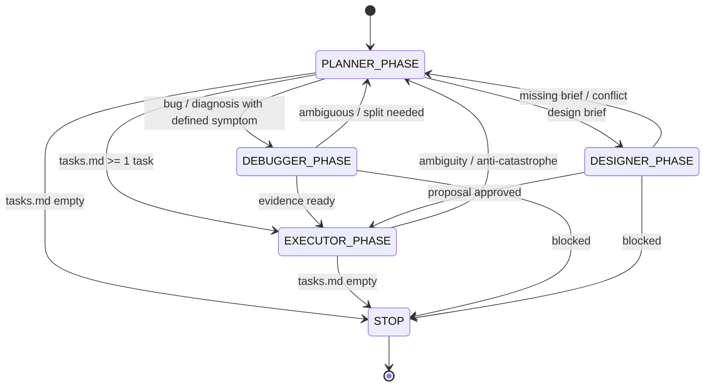

# Architecture — Themis Governance System

## System Overview

Themis is a **deterministic governance kernel** for LLM-based agents. It enforces
a closed state machine that makes AI behavior predictable in production.

The repository has three layers:

1. **Protocol layer** (`themis/*.md`): the contract, loops, roles, tasks, and
   templates consumed by the LLM.
2. **Enforcement layer** (`core/`): Python modules that validate the structure,
   enforce PRE-FLIGHT, and implement the state machine.
3. **Tooling layer** (`cli.py`): scaffolding, validation, and PRE-FLIGHT
   execution from the terminal.

## Governance Loop (State Machine)



The runtime representation lives in `core/loop.py` (`LoopOrchestrator`,
`VALID_PHASES`, `VALID_TRANSITIONS`).

## Role Hierarchy

```text
┌─────────────────────────────────────────────────────────┐
│              THEMIS GOVERNANCE KERNEL                   │
│  (agent.md — PRE-FLIGHT mandatory for all agents)       │
└─────────────────────────────────────────────────────────┘
                              │
    ┌───────────┬───────────┬───────────┬───────────┐
    │           │           │           │           │
    ▼           ▼           ▼           ▼           ▼
  PLANNER   EXECUTOR   DEBUGGER   SECURITY   ARCHITECT
  (plan)    (execute)  (diagnose) (guard)    (structure)
                              │           │
                              ▼           ▼
                          QA_ENGINEER  DOCUMENTATOR
                          (verify)     (docs)
                              │           │
                              ▼           ▼
                          DEVOPS_ENG   PRODUCT_OWNER
                          (pipeline)  (value)
                              │
                              ▼
                          DESIGNER
                          (visual)
```

## Decision Gates

| Gate | Role | Veto Power | Blocks |
|------|------|------------|--------|
| Security | Security Engineer | Yes | Any unsafe execution |
| Quality | QA Engineer | Yes | STOP without passing verification |
| Architecture | Architect | Yes | Structural changes without approval |
| Visual | Designer | Yes | Unauthorized visual changes |
| Documentation | Documentator | Yes | STOP without updated docs |
| Deployment | DevOps Engineer | Yes | Pipeline-breaking changes |
| Value | Product Owner | Yes | Low-value task candidates |

Veto precedence: `security > qa > architect > designer > documentator > devops > product_owner`.

## PRE-FLIGHT Contract

Every agent action must begin with:

```text
PRE-FLIGHT OK
ROLE: <role>
MODE: <roles-loop|manual>
CYCLE_ID: <ISO timestamp>
```

Then read in order:

1. `themis/agent.md` — central contract
2. `themis/loops/roles-loop.md` — state machine
3. `themis/roles/<ROLE>.md` — role boundaries

## Anti-Catastrophe Rules

Execution is blocked when:

- More than 5 files would be modified.
- A structural refactor is attempted.
- An unauthorized architecture change is proposed.
- The task is ambiguous or non-atomic.

## Package Architecture

| Module | Responsibility |
|--------|----------------|
| `core/kernel.py` | Structure validation, role/mode validation, PRE-FLIGHT |
| `core/roles.py` | Role registry, boundaries, and write paths |
| `core/loop.py` | Phases, transitions, history, anti-catastrophe |
| `cli.py` | `init`, `validate`, `run-cycle`; packaging entry point |
| `themis/` | Markdown assets shipped with the package |

`themis` is both a documentation directory and a Python package that ships the
Markdown assets. This allows `themis init` to scaffold a repository even when the
tool is installed from a wheel.

## File Paths

All governance artifacts live under `themis/`:

| Path | Purpose |
|------|---------|
| `themis/agent.md` | Central governance contract |
| `themis/PATHS.md` | Single source of paths |
| `themis/loops/roles-loop.md` | State machine definition |
| `themis/loops/context-freeze.md` | Context snapshotting |
| `themis/loops/memory-loop.md` | Execution traceability |
| `themis/roles/*.md` | Individual role boundaries |
| `themis/tasks/tasks.md` | Active atomic tasks |
| `themis/tasks/archives/task-archives.md` | Completed task log |
| `themis/templates/` | Human-facing templates |
| `themis/outputs/` | Runtime reports (generated) |

## Verification

The project is verified with:

```bash
python -m unittest discover -s tests -v
python cli.py validate
```

CI runs the same checks on Python 3.10, 3.11, and 3.12, and verifies that the
package installs and the `themis` entry point works.
