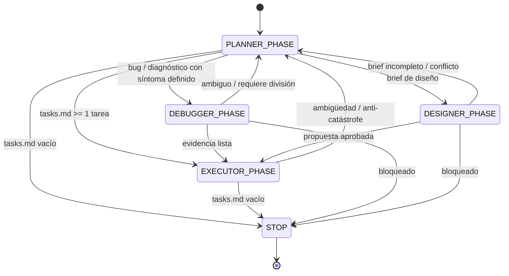

# Arquitectura — Sistema de Gobernanza Themis

## Visión general

Themis es un **kernel de gobernanza determinista** para agentes basados en LLM.
Impone una máquina de estados cerrada que hace predecible el comportamiento de la
IA en producción.

El repositorio tiene tres capas:

1. **Capa de protocolo** (`themis/*.md`): contrato, loops, roles, tareas y
   plantillas que consume el LLM.
2. **Capa de enforcement** (`core/`): módulos Python que validan la estructura,
   imponen el PRE-FLIGHT e implementan la máquina de estados.
3. **Capa de herramientas** (`cli.py`): scaffolding, validación y ejecución de
   PRE-FLIGHT desde la terminal.

## Loop de gobernanza (máquina de estados)



La representación en runtime vive en `core/loop.py` (`LoopOrchestrator`,
`VALID_PHASES`, `VALID_TRANSITIONS`).

## Jerarquía de roles

```text
┌─────────────────────────────────────────────────────────┐
│              THEMIS GOVERNANCE KERNEL                   │
│  (agent.md — PRE-FLIGHT obligatorio para todo agente)   │
└─────────────────────────────────────────────────────────┘
                              │
    ┌───────────┬───────────┬───────────┬───────────┐
    │           │           │           │           │
    ▼           ▼           ▼           ▼           ▼
  PLANNER   EXECUTOR   DEBUGGER   SECURITY   ARCHITECT
  (plan)    (execute)  (diagnose) (guard)    (structure)
                              │           │
                              ▼           ▼
                          QA_ENGINEER  DOCUMENTATOR
                          (verify)     (docs)
                              │           │
                              ▼           ▼
                          DEVOPS_ENG   PRODUCT_OWNER
                          (pipeline)  (value)
                              │
                              ▼
                          DESIGNER
                          (visual)
```

## Gates de decisión

| Gate | Rol | Poder de veto | Bloquea |
|------|-----|---------------|---------|
| Seguridad | Security Engineer | Sí | Cualquier ejecución insegura |
| Calidad | QA Engineer | Sí | STOP sin verificación aprobada |
| Arquitectura | Architect | Sí | Cambios estructurales sin aprobación |
| Visual | Designer | Sí | Cambios visuales no autorizados |
| Documentación | Documentator | Sí | STOP sin documentación actualizada |
| Despliegue | DevOps Engineer | Sí | Cambios que rompen el pipeline |
| Valor | Product Owner | Sí | Candidatos de bajo valor |

Precedencia de vetos: `security > qa > architect > designer > documentator > devops > product_owner`.

## Contrato PRE-FLIGHT

Toda acción del agente debe comenzar con:

```text
PRE-FLIGHT OK
ROLE: <rol>
MODE: <roles-loop|manual>
CYCLE_ID: <timestamp ISO>
```

Luego leer en orden:

1. `themis/agent.md` — contrato central
2. `themis/loops/roles-loop.md` — máquina de estados
3. `themis/roles/<ROL>.md` — límites del rol

## Reglas anti-catástrofe

La ejecución se bloquea cuando:

- Se modificarían más de 5 archivos.
- Se intenta un refactor estructural.
- Se propone un cambio de arquitectura no autorizado.
- La tarea es ambigua o no atómica.

## Arquitectura del paquete

| Módulo | Responsabilidad |
|--------|-----------------|
| `core/kernel.py` | Validación de estructura, rol/modo y PRE-FLIGHT |
| `core/roles.py` | Registro de roles, límites y rutas de escritura |
| `core/loop.py` | Fases, transiciones, historial y anti-catástrofe |
| `cli.py` | `init`, `validate`, `run-cycle`; entry point del paquete |
| `themis/` | Activos Markdown empaquetados con el paquete |

`themis` es a la vez un directorio de documentación y un paquete Python que
distribuye los activos Markdown. Esto permite que `themis init` cree la estructura
incluso cuando la herramienta se instala desde un wheel.

## Rutas de archivos

Todos los artefactos de gobernanza viven bajo `themis/`:

| Ruta | Propósito |
|------|-----------|
| `themis/agent.md` | Contrato central de gobernanza |
| `themis/PATHS.md` | Fuente única de rutas |
| `themis/loops/roles-loop.md` | Definición de la máquina de estados |
| `themis/loops/context-freeze.md` | Congelación de contexto |
| `themis/loops/memory-loop.md` | Trazabilidad de ejecuciones |
| `themis/roles/*.md` | Límites individuales de cada rol |
| `themis/tasks/tasks.md` | Tareas atómicas activas |
| `themis/tasks/archives/task-archives.md` | Bitácora de tareas completadas |
| `themis/templates/` | Plantillas para humanos |
| `themis/outputs/` | Informes en runtime (generados) |

## Verificación

El proyecto se verifica con:

```bash
python -m unittest discover -s tests -v
python cli.py validate
```

CI ejecuta las mismas verificaciones en Python 3.10, 3.11 y 3.12, y comprueba que
el paquete instala y que el entry point `themis` funciona.
