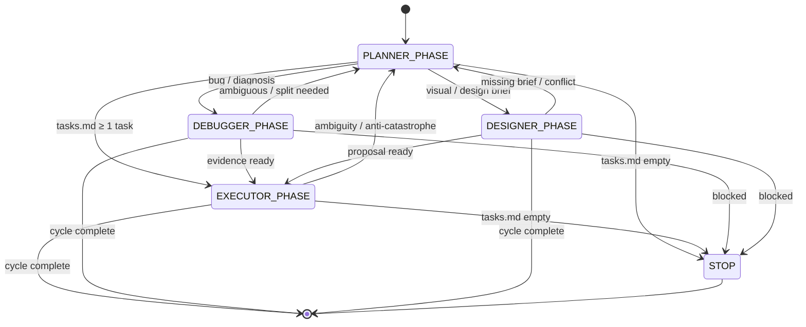

# Architecture — Themis Governance System

## System Overview

Themis is a **deterministic governance kernel** for LLM-based agents. It enforces
a closed state machine that makes AI behavior predictable in production.

## Governance Loop (State Machine)



## Role Hierarchy

```
┌─────────────────────────────────────────────────────────┐
│              THEMIS GOVERNANCE KERNEL                   │
│  (agent.md — PRE-FLIGHT mandatory for all agents)       │
└─────────────────────────────────────────────────────────┘
                              │
    ┌───────────┬───────────┬───────────┬───────────┐
    │           │           │           │           │
    ▼           ▼           ▼           ▼           ▼
  PLANNER   EXECUTOR   DEBUGGER   SECURITY   ARCHITECT
  (plan)    (execute)  (diagnose) (guard)    (structure)
                              │           │
                              ▼           ▼
                          QA_ENGINEER  DOCUMENTATOR
                          (verify)     (docs)
                              │           │
                              ▼           ▼
                          DEVOPS_ENG  PRODUCT_OWNER
                          (pipeline)  (value)
                              │
                              ▼
                          DESIGNER
                          (visual)
```

## Decision Gates

| Gate | Role | Veto Power | Blocks |
|------|------|------------|--------|
| Security | Security Engineer | Yes | Any unsafe execution |
| Quality | QA Engineer | Yes | STOP without passing tests |
| Architecture | Architect | Yes | Structural changes without approval |
| Documentation | Documentator | Yes | STOP without updated docs |
| Deployment | DevOps Engineer | Yes | Pipeline-breaking changes |
| Value | Product Owner | Yes | Low-value task candidates |
| Visual | Designer | Yes | Unauthorized visual changes |

## PRE-FLIGHT Contract

Every agent action must begin with:

```
PRE-FLIGHT OK
ROLE: <role>
MODE: <roles-loop|manual>
CYCLE_ID: <ISO timestamp>
```

Then read in order:
1. `themis/agent.md` — Central contract
2. `themis/loops/roles-loop.md` — State machine
3. `themis/roles/<ROLE>.md` — Role boundaries

## Anti-Catastrophe Rules

Execution is blocked when:
- More than 5 files would be modified
- Structural refactor is attempted
- Unauthorized architecture change
- Task is ambiguous or non-atomic

## File Paths

All governance artifacts live under `themis/`:

| Path | Purpose |
|------|---------|
| `themis/agent.md` | Central governance contract |
| `themis/loops/roles-loop.md` | State machine definition |
| `themis/loops/context-freeze.md` | Context snapshotting |
| `themis/loops/memory-loop.md` | Execution traceability |
| `themis/roles/*.md` | Individual role boundaries |
| `themis/tasks/tasks.md` | Active atomic tasks |
| `themis/tasks/archives/task-archives.md` | Completed task log |
| `themis/templates/` | Human-facing templates |
